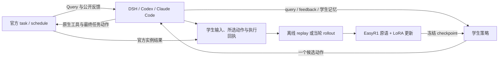
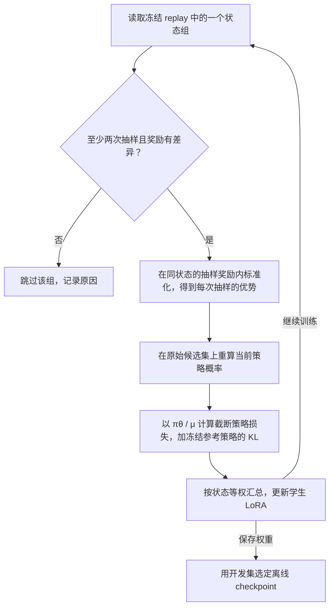
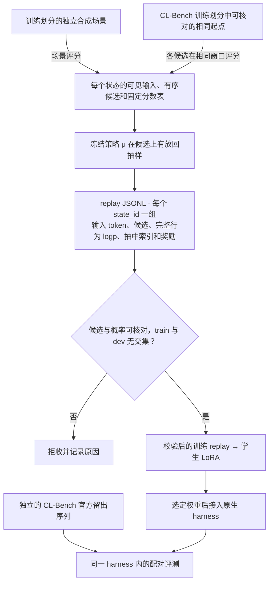
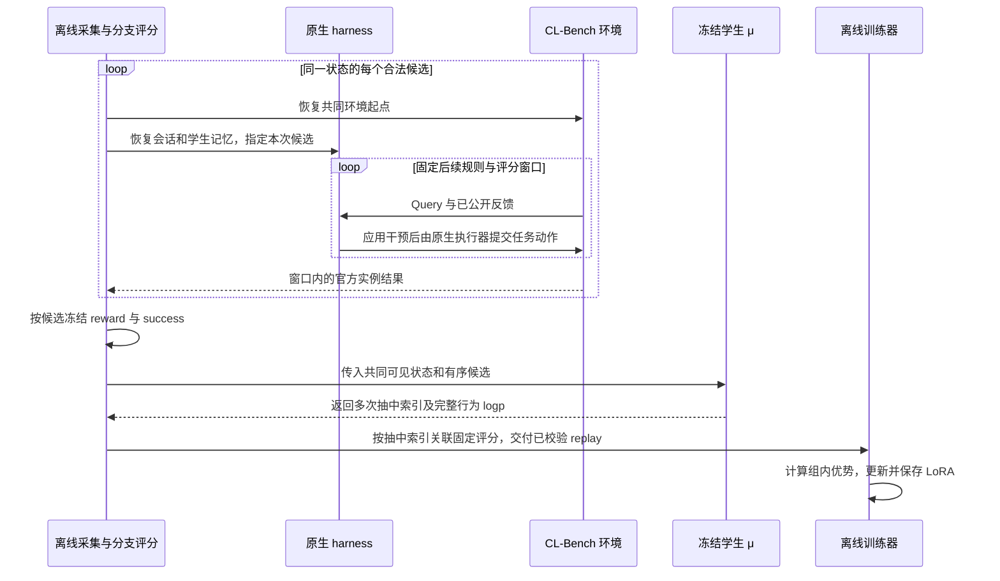
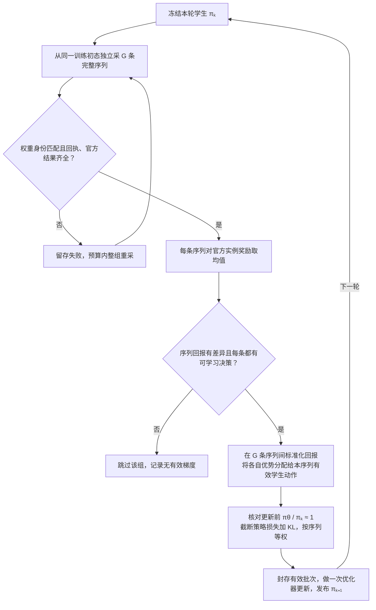
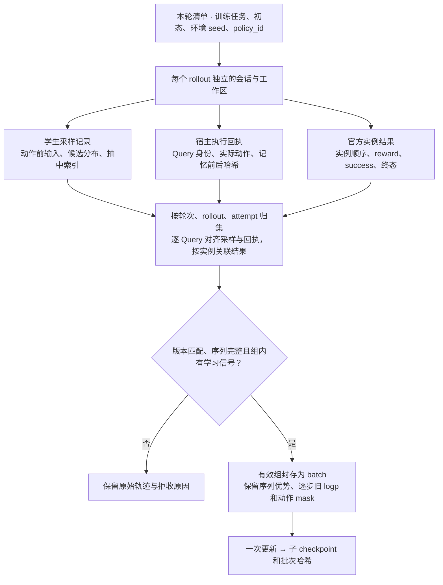
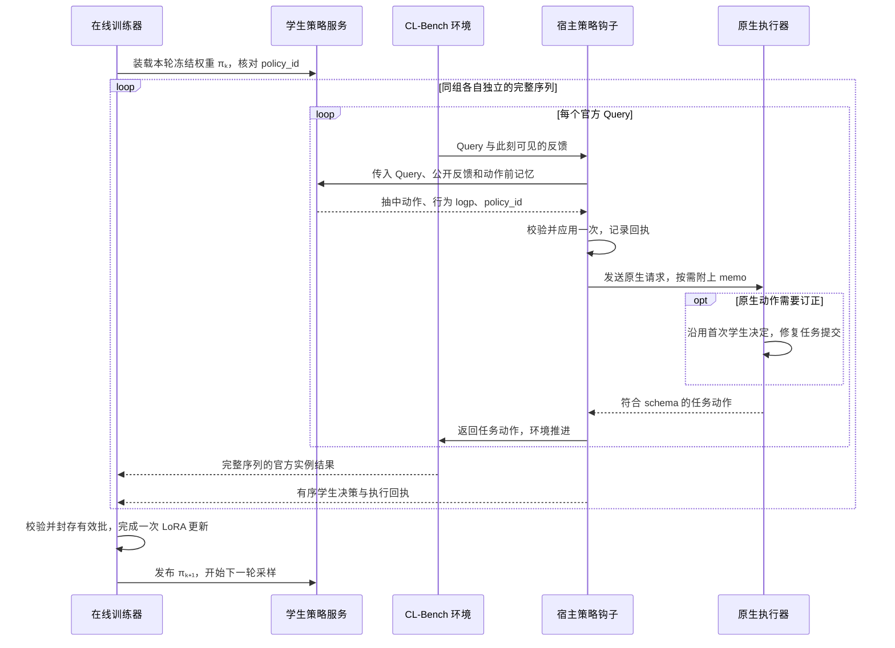

# 01｜总体方案与架构

2026-11-20 · 实施计划 · [数据协议](02_数据协议与验收.md) · [复用决策](03_代码复用与接入决策.md) · [实施阶段](04_实施阶段与扩展.md) · [文件架构](05_初始文件架构.md)

**训练一个记忆策略，接入三个原生 harness。** 沿用 DSH 成功案例的分工。每个官方 Query 开始时，学生从当前允许的候选中选择一次 `noop / recall / compact / write`。DeepSeek Harness（DSH）、Codex 或 Claude Code 继续解题和调用工具，Continual Learning Bench（下文简称 CL-Bench）执行任务并评分。首版沿用 Qwen3-8B LoRA 和离散动作 GRPO。

**交付单位是整个 `skill_rl_train/` 目录。** 把它复制到一台干净的训练机，按根目录 README 安装环境、指定 Qwen 权重和 tokenizer，就应能用随项目提供的 v2 场景生成器完成采样、校验、单卡训练和开发集评估。使用自有 replay 时直接传入数据文件。运行 CL-Bench 实验另需对应任务资源、选定的原生 CLI 及其凭据。实验代码、官方任务与评分实现、插件、配置、依赖清单和测试均随项目交付。

| 从一份源码副本起步 | 机器另需准备 | 最小可验收结果 |
|---|---|---|
| 单卡离线首训 | 训练 Python、兼容 GPU 驱动、可安装的依赖、Qwen 基座和 tokenizer | 从空 `runs/` 生成 train/dev，保存有参数更新的 LoRA 和开发集报告。全程可不配置任何 harness |
| 自有离线数据 | 上述训练资源，加带行为概率和评分来源的 replay | 使用同一个训练入口；记录输入指纹、权重身份及恢复状态 |
| 三端 CL-Bench 实验 | 加 benchmark Python、所选端的原生 CLI/镜像、凭据与该任务的数据 | 使用项目内的官方任务与评分器运行，按实例回查干预回执、奖励与原始轨迹 |

## 1. 先回答两个实验问题

| 实验 | 数据怎样来 | 要比较什么 |
|---|---|---|
| Off-policy | 冻结行为策略 μ、学生可见状态、候选动作及下游分数，生成带真实行为概率的固定 replay，可重复读取 | 同一 harness 内，离线训练的学生相对未训练学生和原生系统，能否提高官方留出 reward |
| On-policy | 在允许训练的 CL-Bench 序列上，冻结当前学生 πₖ，独立跑多条完整序列，学生全程随机决策。用该轮结果更新一次，再用 πₖ₊₁ 重新采集 | 从同一初始权重出发，在线采样能否学到离线数据没覆盖的、对后续实例有用的记忆动作 |

两类实验各接三端。第一步用独立项目完成单卡训练并在 DSH 上对齐历史基线，第二步跑通两轮在线更新，最后把相同策略接到 Codex 和 Claude Code。训练器只读取学生决策和分数。每个 harness 可以独立部署、独立失败、独立报告。

## 2. 起点与可验证的事实

| 起点 | 已有能力 | 本计划从哪里接 |
|---|---|---|
| 本地 `skill_rl_train/EasyR1` | Git 提交 `a73346d028ba0335aa42da104972c86e6cd0fe69`，与旧训练后端固定值一致 | 原样加载 `DataProto`、policy loss、KL 和可用的 GRPO 优势函数 |
| 远程 `Skill_RSI_RL` | Qwen3-8B LoRA 离线训练、学生服务、DSH 官方三臂评测都有落盘产物 | 以同一次运行的 replay、选中权重与官方报告作为复现对象，位置见 [04](04_实施阶段与扩展.md) |
| `Skill_RSI_hzh` 与官方 benchmark | DSH 有每 Query 决策与回执。官方 Codex、Claude Code 系统已有原生 CLI、会话、修复及产物出口 | 后两端共用一个 Query 包装器，优先验证决策实际生效与 reset 边界 |
| `context-language-models/clm` | 有上下文变更后的可见输入分段规范，以及在指定动作上分配优势的例子 | 保存学生当时看到的输入，并只给学生实际采样的动作计算梯度 |

远程 Poker 与 Spectrum 正式配对均已完成，旧报告对两项任务均未判定训练带来增益。这两份报告用于对齐工程链路。新项目的三端在线训练需在目标机上分别验收。

上表记录代码来源和历史证据。发行目录内保留 `EasyR1/`、`vendor/continual-learning-bench/`、学生训练包和三端桥接。历史训练项目与 CLM 用于追溯实现决策。最终验收从不带 Git 元数据的源码副本启动，旧工作区和远程历史挂载均可下线。[独立目录结构](05_初始文件架构.md)

## 3. 一次决策如何穿过框架

| 责任 | 拥有的状态 | 对外边界 |
|---|---|---|
| Benchmark | 任务环境、实例顺序、计分与 reset 规则 | 给原生系统 Query，接收符合 schema 的任务动作，输出官方 outcomes |
| Harness | 每条序列的原生会话、工具、workspace 与隔离的学生记忆 | Query 前应用一次学生动作，返回任务响应并写执行回执。协议订正沿用第一次决策 |
| 策略 | 候选规则、tokenizer、基座与 LoRA | 给出动作与策略身份。训练采样还需返回真实抽样分布 |
| 训练 | 当前轮、数据指纹、优化器和 checkpoint | 读取合格数据、更新学生、发布冻结版本。训练进程无需启动原生 CLI |

### 3.1 学生学什么：用一次交接记录看四个动作

每个 Query 到来时，学生可见当前问题、已经公开的反馈和这条序列自己的键值记忆。项目代码据此生成带字母标签的有限候选，每个标签对应一个已填好参数的动作。学生学习的是在**当前证据、可见上下文和后续需求**下给候选排序。键、待写文本和摘录算法由合同给出，原生执行器负责解题。下面用同一个简化的库存交接问题说明四种不同的证据状态。编号仅用于示例。[动作实现](../skill_rsi_rl/contracts.py) · [v2 对照场景](../skill_rsi_rl/scenarios_v2.py)

| 动作 | 此刻怎样改变执行器输入或记忆 | 要学会的判断 | 同一交接任务中的例子 |
|---|---|---|---|
| `noop` 跳过 | 保留学生记忆，本次不附 memo | 当前公开证据是否已经充分；多附一段旧资料会不会占预算或引入冲突 | 当前交接单已经写明 A=R17、B=R42，记忆也已有 B 的正确编号。直接继续 |
| `recall` 回读 | 把候选指定键的原文按顺序加入本次 memo，受总长度上限约束；存储不变 | 哪些旧条目与眼前问题相关；是否必须保留原文后段的细节 | 当前只看到 A 的编号；B 的正确编号位于旧记录末尾。选择只回读 B 的候选，让执行器看到完整证据 |
| `compact` 摘录 | 将候选中各条目的空白合并，每条取前 240 字符，再拼入本次 memo。原始记忆保留 | 多条证据能否在预算内共同出现；关键值是否位于会保留的前缀 | A、B 的编号都在条目开头，A 后面有很长的流水记录。选择多条摘录后，本次 memo 能同时容纳两个编号 |
| `write` 写入或更新 | 把候选中已有的公开反馈文本存到指定键；可以新增或覆盖。本步不附 memo | 哪条新反馈值得保留、何时替换过期信息，以及后续回读能否受益 | 已公开的签收反馈把 B 从 R09 更正为 R42。当前能直接作答，仍选择写入更正；下一次只问 B 时再回读 |

例如，`write → recall` 横跨两个 Query。第一步的直接证据是记忆内容改变，第二步的直接证据是执行器输入出现更正后的原文。离线 v2 用同题不同证据位置的候选对照，考察当前查对、后续读取和 memo 开销。在线实验则用整条官方序列的回报给所选动作分配优势；一次高分不能单独证明其中某次写入有因果收益。空记忆且没有可写反馈时只有 `noop`，该步按强制动作处理。

## 4. 离线实验（off-policy）

以下三图沿用已验证的 DSH 离线训练器。历史运行以合成场景给候选动作评分。改用 CL-Bench 数据时，由同一环境与会话起点的候选分支提供评分。两种来源使用同一 replay 格式。

### 4.1 算法流程图 · 在固定状态上更新学生

分母 μ 取自采集时的真实行为分布，包括当时的温度和均匀探索比例。训练多轮时可以重复读取同一批数据。[查看离线算法图 SVG](assets/diagrams/offline-algorithm.svg)

### 4.2 数据流程图 · 从候选评分到 replay

同一状态中的同一候选被抽中两次时，两条样本引用同一份已冻结评分。清单保留分数来源，官方留出结果只进入评测报告。[查看离线数据图 SVG](assets/diagrams/offline-data.svg)

### 4.3 时序图 · 一组 CL-Bench 候选怎样获得训练奖励

指定候选只作用于分支起点，后续步骤遵循同一控制规则。DSH 的 Poker 分支已有评分入口，Codex 和 Claude Code 需分别验证可恢复的共同起点。[查看离线时序图 SVG](assets/diagrams/offline-sequence.svg)

## 5. 在线实验（on-policy）

在线训练的分组单位是一组完整序列。每条序列从相同实验初态独立运行，学生动作会改变后续可见记忆，因此序列可以走向不同状态。

### 5.1 算法流程图 · 每次更新后用新权重重新采样

单候选的强制步掩去。有效批次只更新一次，下一轮使用新学生重新与环境交互。达到采样预算仍无有效组时，记录该轮无更新。[查看在线算法图 SVG](assets/diagrams/online-algorithm.svg)

### 5.2 数据流程图 · 把真实决策连到延迟奖励

`write` 在本步改变记忆，收益可能出现在之后的实例。训练器通过完整 rollout 关联这段回报，并屏蔽原生执行器和工具产生的内容。[查看在线数据图 SVG](assets/diagrams/online-data.svg)

### 5.3 时序图 · 从一次 Query 到下一轮权重

图中展示正常采样。若策略服务超时或返回动作无法通过校验，宿主记录 `fallback/noop` 后继续原生执行，训练端将该组标为需要重采。官方 reward 在实例结算时产生。[查看在线时序图 SVG](assets/diagrams/online-sequence.svg)

## 6. 第一版完成的定义

1. 在只提供本项目源码的干净环境，从项目根在单卡完成 v2 数据生成、校验、真实 LoRA 更新和开发集评估。验收产物包括可加载的 adapter、恢复状态和开发集报告。接入 DSH 后，能由服务回执追到同一 checkpoint。
2. 在每个 harness 有一项冻结 replay 的 off-policy 实验，以及至少两轮使用新权重重新采样的 on-policy 实验。报告明确区分共享离线数据迁移与该 harness 自产数据训练。
3. 每端用同一留出序列比较原生、未训练、离线训练、在线训练四臂。链路可用与收益成立分别给结论，负结果照样交付。
